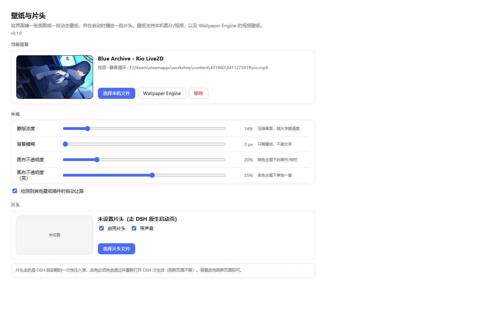
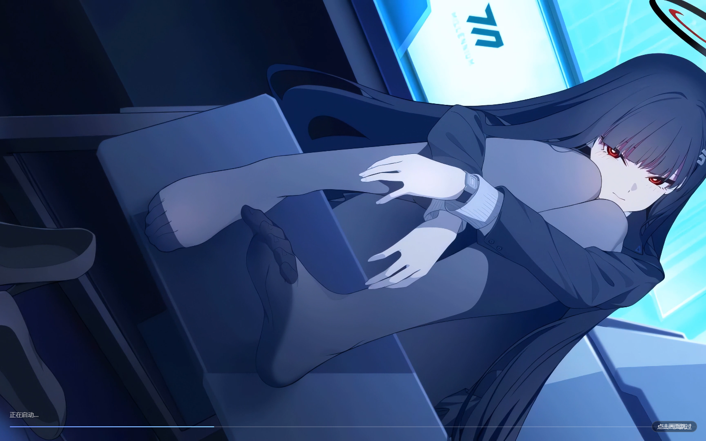
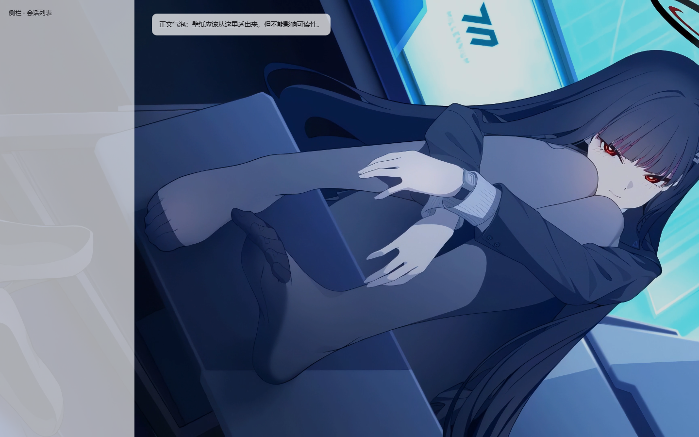
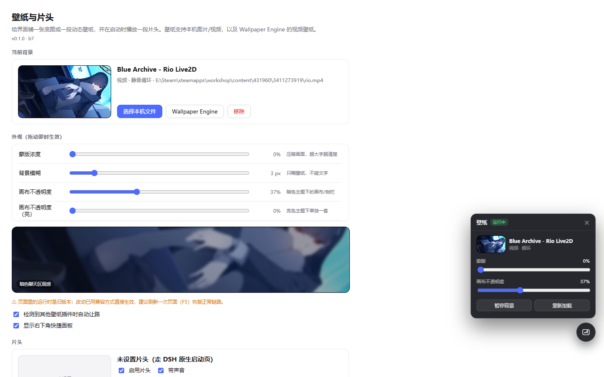
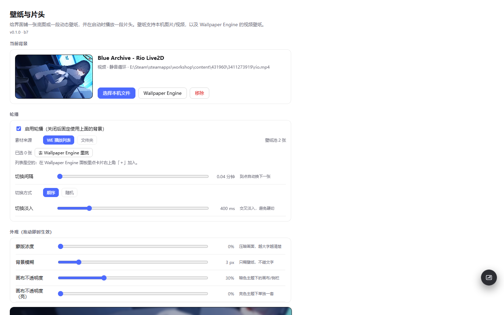

# dsh-wallpaper-intro · 壁纸与片头

给 DeepSeek Harness 的 Web 界面铺一张底图或一段动态壁纸，并在启动时播放一段可自定义的片头。

- 背景支持：**本机图片 / 视频**、**Wallpaper Engine 视频壁纸**（自动扫描本机库）
- 片头支持：任意视频或图片，可调展示时长、淡出、声音，随时点击跳过
- 外观可调：蒙版、模糊、画布不透明度（亮/暗各一套），**拖动即时生效**
- 轮播：从 Wallpaper Engine 里勾选一批，或指定一个文件夹，按间隔自动换
- 右下角快捷面板：暂停背景、下一张、轮播开关、重载页面



| 片头 | 背景 |
| --- | --- |
|  |  |

| 快捷面板 | 轮播 |
| --- | --- |
|  |  |

---

## 功能状态

### ✅ 已实现

| 能力 | 说明 |
| --- | --- |
| 片头 · 自定义素材 | 任意视频（mp4/webm/ogv）或图片（含 GIF），启动时全屏播放 |
| 片头 · 参数 | 展示时长（0 = 随素材）、淡出时长、带声音/静音、三处文案 |
| 片头 · 交互 | 点击画面 / Esc / 空格 / 回车随时跳过；播完自动淡出 |
| 片头 · 预览 | 设置页里直接预览，不用重启 |
| 背景 · 本机文件 | 任意磁盘路径的图片或视频，路径选择器 + 目录浏览 + 常用目录 |
| 背景 · Wallpaper Engine | 自动扫描本机库（工坊 / 我的项目 / 官方），视频壁纸直接实时播放；场景与 Web 壁纸取封面图 |
| 背景 · 桌面当前壁纸 | 一键「就用我现在这张」 |
| 外观 · 四项可调 | 蒙版浓度、模糊、画布不透明度（暗/亮各一套） |
| 外观 · 实时生效 | 拖动滑杆立刻作用于主界面，带一处合成预览 |
| 轮播 · WE 播放列表 | 在 WE 面板里点「＋」勾选，只在这些里轮换 |
| 轮播 · 文件夹 | 指定目录（一层），里面的图片/视频自动成池 |
| 轮播 · 规则 | 间隔 1–240 分钟、顺序/随机、交叉淡入；总开关；**关闭时淡回基础壁纸** |
| 快捷面板 | 右下角圆钮：暂停背景、下一张、轮播开关、重载页面 |
| 共存 | 检测到其他壁纸插件时自动让路，撤掉后自动接回 |
| 其他 | 媒体 Range 流（可拖进度）、配置持久化、运行时可动态更新框架/样式 |

### 🚧 未实现（将来可能做）

详细构想、技术路径与风险评估见 **[ROADMAP.md](ROADMAP.md)**。

| 想法 | 现状 |
| --- | --- |
| **场景（scene）壁纸真渲染** | 112 张场景壁纸目前只显示静态封面，不会动。完整渲染需移植 `webwallgl` 并在浏览器里做 HLSL→GLSL 翻译，评估 15–25 人日且有兼容长尾，**暂缓** |
| **Web 壁纸渲染** | 目前只取封面图；需要沙箱 iframe + WE API shim（本机仅 3 张，收益最低） |
| **虚拟 faststart** | 约 35% 的 mp4 索引在文件尾，首帧慢；计划响应时重排 box |
| 文件夹轮播递归子目录 | 目前只看一层 |
| 按时间段轮播 | 例如夜间换上深色壁纸 |
| 多显示器支持 | 目前只取 `Monitor0` |
| 片头随机多段 / 壁纸分类 / 读取 WE 自己的播放列表 / 按会话切壁纸 / 亮度自适应 / 轮播预加载 | 只记录在 ROADMAP，未排期 |

---

## 安装

```sh
# 从 Release 安装（推荐，固定版本）
dsh plugin --profile desktop add https://github.com/fengyevvv/dsh-wallpaper-intro/releases/latest/download/dsh-wallpaper-intro-0.1.0.tgz

# 或跟随仓库最新
dsh plugin --profile desktop add github:fengyevvv/dsh-wallpaper-intro

# 本地目录（开发时）
dsh plugin --profile desktop add link:E:\path\to\dsh-wallpaper-intro
```

桌面版请通过 **设置 → 插件 → 添加插件** 安装，装完**完全退出并重新打开 DSH**。

> 为什么必须重启：DSH 的注入表是宿主启动时的一次性快照，插件装配也在启动期完成。

## 使用

- **设置 → 壁纸与片头**：所有配置都在这里
- **右下角圆钮**：不用进设置就能暂停背景、切下一张、开关轮播

### 片头

选一个视频/图片即可。参数：

| 项 | 默认 | 说明 |
| --- | --- | --- |
| 展示时长 | 0（随素材） | 0 = 播完为止；也可指定秒数，到点交接 |
| 淡出时长 | 900ms | 固定值，不会缩水成硬切 |
| 带声音 | 开 | 被浏览器拦截时自动退回静音 |

片头期间**点画面、Esc、空格、回车**都能跳过。

### 轮播

两种素材来源：

- **WE 播放列表**：在 Wallpaper Engine 面板里点卡片右上角「＋」勾选，只在选中的几张里轮换
- **文件夹**：指定一个目录（只看一层），里面的图片/视频自动成为素材池

间隔 1–240 分钟，顺序或随机，切换带交叉淡入。**关掉开关会淡回基础壁纸**（不会停在最后一张）。

## 配置

配置存在 `$DSH_HOME/dsh-wallpaper-intro.json`（一般是 `~/.dsh/`），升级插件不会丢：

```json
{
  "boot":       { "enabled": true, "file": "", "durationSec": 0, "fadeMs": 900, "sound": true, "volume": 0.8 },
  "background": { "enabled": true, "file": "", "title": "", "source": "local" },
  "appearance": { "veil": 0.14, "surface": 0.2, "surfaceLight": 0.55, "blur": 0 },
  "we":         { "autoYield": true },
  "overlay":    { "enabled": true },
  "rotation":   { "enabled": false, "source": "list", "items": [], "folder": "", "intervalMin": 30, "mode": "sequential", "fadeMs": 700 }
}
```

## 已知限制

- **场景（scene）壁纸只当静态封面**：`scene.pkg` 是实时渲染包，不是视频。插件取它自带的 `preview.jpg` 当静态背景，**不会动**。本机 209 张里有 112 张是场景壁纸。
- **Web 壁纸**同样只取封面图。
- **场景/Web 壁纸不能当片头**（只能拿封面图，效果差）。
- **4K 片头预览可能卡**：预览要同时解码视频，切片或换 1080p 素材更顺。
- **正式版 DSH 没有 F5**：桌面正式版不注册重载快捷键，所以"改完刷新页面"不成立。用快捷面板里的「重载页面」按钮，或重启应用。

## 生效规则（改这个插件的人需要知道）

| 改动 | 生效方式 |
| --- | --- |
| `runtime.js` / `runtime.css` | 点快捷面板「重载页面」 |
| `client.js` | 完全重启 DSH |
| `index.js` / `lib/*` | 完全重启 DSH |
| 片头参数 | 完全重启 DSH（注入行是启动快照） |
| 背景 / 外观 / 轮播参数 | 重载页面 |

## 路线图

未实现的想法、技术路径、工作量评估、风险与决策记录，都写在 **[ROADMAP.md](ROADMAP.md)**；上面「功能状态」一节有摘要。

## 开发

插件分两半：

```
index.js        宿主半：路由、媒体流、WE 扫描、索引注入
runtime.js/css  注入页面：片头覆盖层、背景层、轮播
client.js       客户端：设置页、右下角快捷面板
lib/            配置、媒体、WE 扫描、注入引导
tests/          本地验证脚手架（真 Chromium + CDP 截图）
```

`tests/` 里有一套可复现的验证工具：

```sh
node tests/serve.mjs                     # 本地服务（代理到运行中的 DSH）
node tests/make-injection-page.mjs       # 用真实引导脚本生成测试页
node tests/shot.mjs <url> <out.png> 3000 # CDP 截图
```

## 许可

MIT，见 [LICENSE](LICENSE)。

不读取、不修改 Wallpaper Engine 的安装目录内容；只按需读取壁纸文件并本地提供。
